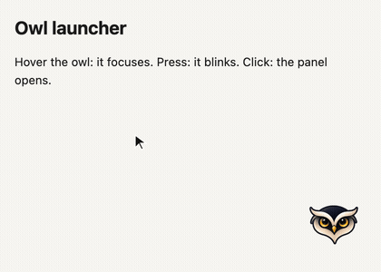

# Owl launcher

A floating bottom-right assistant button: an owl's head that reacts to the pointer.



- **Calm** at rest
- **Focused** on hover, on keyboard focus, or while busy
- **Blinks** while pressed
- Click opens your panel

Three stacked face images (`assets/owl-*.webp`), so switching eyes never waits for an image to load.

## Try it

Open `demo/index.html` in a browser (plain HTML + JS, no build).

## React

```tsx
import { OwlLauncher } from "./src/OwlLauncher"

<OwlLauncher onOpen={() => setOpen(true)} busy={loading} label="Open assistant" />
```

`Owl` alone (`<Owl eyes="hunter" size={28} />`) works for headers and avatars. The component needs a bundler that imports `.webp` files (Vite, Next.js, etc.).

Note: only keyboard focus sets the focused eyes. In Chrome a mouse press also focuses the button, which would otherwise hide the blink.

## License

MIT
